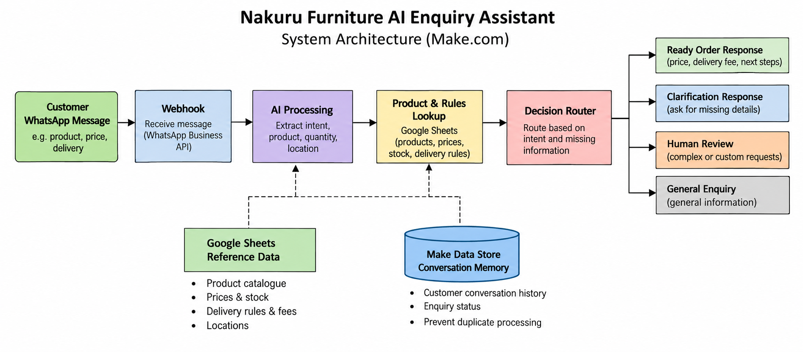
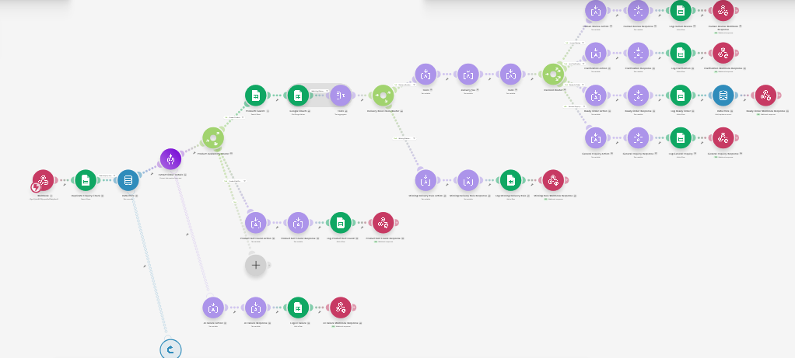
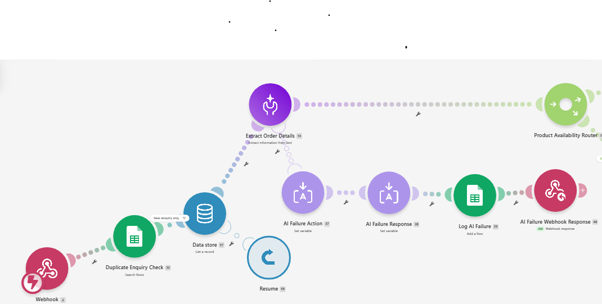
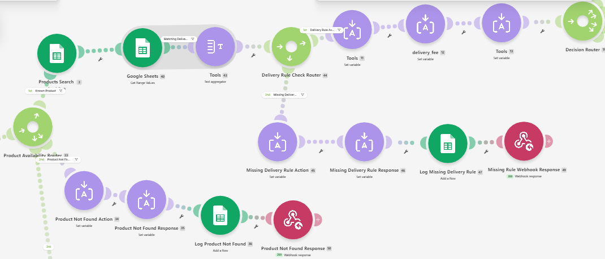
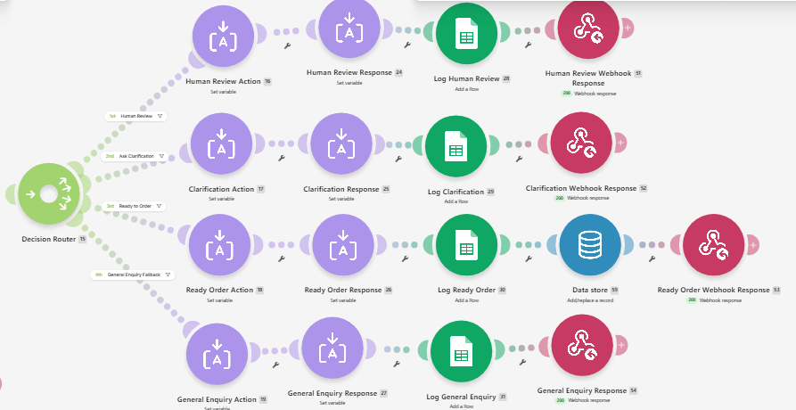

# Nakuru Furniture AI Enquiry Assistant

An AI-powered WhatsApp customer enquiry and order-qualification automation built with Make.com.

The system processes natural-language customer messages, identifies the product and order requirements, retrieves business information, applies delivery and payment rules, maintains conversation context, and determines the appropriate next action.

## Business Problem

Furniture businesses frequently receive repetitive WhatsApp enquiries about:

- Product prices and availability
- Delivery locations and charges
- Payment methods
- Product quantities
- Custom furniture
- Order placement

Handling these enquiries manually can delay responses and requires staff to repeatedly search for product and delivery information.

This project demonstrates how these enquiries can be processed automatically while escalating uncertain or exceptional cases to a human.

## Solution

The automation connects WhatsApp enquiries to a Make.com backend.

A customer can send a message such as:

> I want 2 grey L-shaped sofas delivered to Lanet. Can I pay on delivery?

The system extracts:

- Product: P001 — Grey L-Shaped Fabric Sofa
- Quantity: 2
- Location: Lanet
- Delivery requested: Yes
- Payment method: COD
- Purchase intent: Ready to Buy

It then retrieves authoritative product and business information and calculates:

- Product subtotal: KSh 90,000
- Delivery fee: KSh 800
- Total: KSh 90,800

The enquiry is then routed to the appropriate workflow and a customer response is generated.

## Architecture

The diagram below provides a simplified overview of
the automation architecture.

## Make.com Workflow Screenshots

### 1. Complete Backend Overview

### 2. Webhook, Conversation Memory and AI Extraction

### 3. Product Lookup and Delivery Rules

### 4. Decision Routing and Response Handling

